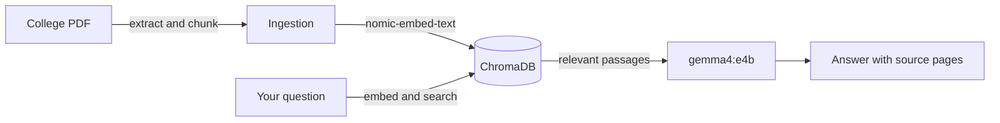

#  College Helpdesk Bot

Ask questions about college information and get answers grounded in the project’s PDF knowledge base, with the relevant source pages available to check.

> **Private and local:** The app uses Ollama for language and embedding models, and ChromaDB for document search. Verify time-sensitive details with official college sources.

## How it works



## Run it

**You’ll need** Python 3.10+ and [Ollama](https://ollama.com/) installed and running.

```bash
python -m venv .venv
source .venv/bin/activate
python -m pip install streamlit chromadb ollama pymupdf

ollama pull gemma4:e4b
ollama pull nomic-embed-text
```

Add the PDF to be indexed at `data/documents/colleage_rules.pdf`, then build the searchable index and launch the app:

```bash
python scripts/ingest_document.py
streamlit run frontend/st_app.py
```

The index is stored locally in `data/chroma/`. The ingestion script splits the PDF into 1,000-character chunks with 150 characters of overlap. Re-run ingestion after changing the source PDF.

## Verify

Run the unit tests with:

```bash
python -m unittest discover -s tests
```
